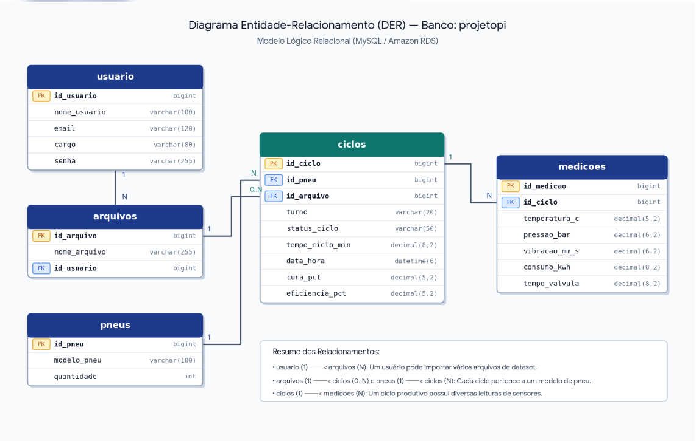

# 📊 Dicionário de Dados — Projeto Integrador (PI)

Este documento descreve a estrutura definitiva do banco de dados relacional (`projetopi`) hospedado no **Amazon RDS (MySQL)**, responsável por armazenar os usuários, arquivos importados e indicadores industriais de vulcanização/produção de pneus.

## 📐 Diagrama Entidade-Relacionamento (DER)

---

## 🗂️ Descrição das Tabelas

### 1. Tabela: `usuario`
Armazena os dados de acesso e perfil dos usuários do sistema.

| Coluna | Tipo de Dado | Chave | Nulo? | Extra / Descrição |
| :--- | :--- | :--- | :--- | :--- |
| `id_usuario` | `bigint` | **PK** | Não | `auto_increment` — Identificador único do usuário. |
| `nome_usuario` | `varchar(100)` | - | Não | Nome completo do usuário. |
| `email` | `varchar(120)` | - | Não | E-mail corporativo utilizado para login. |
| `cargo` | `varchar(80)` | - | Não | Função ou cargo do usuário na operação. |
| `senha` | `varchar(255)` | - | Não | Senha criptografada para autenticação. |

---

### 2. Tabela: `pneus`
Catálogo de modelos de pneus monitorados na linha de produção e suas quantidades.

| Coluna | Tipo de Dado | Chave | Nulo? | Extra / Descrição |
| :--- | :--- | :--- | :--- | :--- |
| `id_pneu` | `bigint` | **PK** | Não | `auto_increment` — Identificador único do modelo de pneu. |
| `modelo_pneu` | `varchar(100)` | - | Não | Nome ou código identificador do modelo do pneu. |
| `quantidade` | `int` | - | Não | Quantidade total registrada/produzida para o modelo. |

---

### 3. Tabela: `arquivos`
Registra os arquivos de datasets importados no sistema e o usuário responsável pelo envio.

| Coluna | Tipo de Dado | Chave | Nulo? | Extra / Descrição |
| :--- | :--- | :--- | :--- | :--- |
| `id_arquivo` | `bigint` | **PK** | Não | `auto_increment` — Identificador único do arquivo importado. |
| `nome_arquivo` | `varchar(255)` | - | Não | Nome original do arquivo enviado. |
| `id_usuario` | `bigint` | **FK** | Não | Referência ao usuário (`usuario.id_usuario`) que realizou o upload. |

---

### 4. Tabela: `ciclos`
Armazena os dados consolidados de cada ciclo de produção/cura dos pneus.

| Coluna | Tipo de Dado | Chave | Nulo? | Extra / Descrição |
| :--- | :--- | :--- | :--- | :--- |
| `id_ciclo` | `bigint` | **PK** | Não | `auto_increment` — Identificador único do ciclo produtivo. |
| `id_pneu` | `bigint` | **FK** | Não | Referência ao modelo de pneu (`pneus.id_pneu`). |
| `id_arquivo` | `bigint` | **FK** | Sim | Referência ao arquivo de origem (`arquivos.id_arquivo`), quando importado em lote. |
| `turno` | `varchar(20)` | - | Não | Turno operacional em que o ciclo ocorreu (ex: Manhã, Tarde, Noite). |
| `status_ciclo` | `varchar(50)` | - | Não | Situação final do ciclo (ex: Concluído, Falha, Em andamento). |
| `tempo_ciclo_min` | `decimal(8,2)` | - | Sim | Duração total do ciclo em minutos. |
| `data_hora` | `datetime(6)` | - | Não | Data e hora de registro do ciclo. |
| `cura_pct` | `decimal(5,2)` | - | Sim | Percentual de cura atingido no processo. |
| `eficiencia_pct` | `decimal(5,2)` | - | Sim | Índice de eficiência operacional do ciclo (%). |

---

### 5. Tabela: `medicoes`
Armazena as leituras detalhadas de sensores e consumo associadas a cada ciclo.

| Coluna | Tipo de Dado | Chave | Nulo? | Extra / Descrição |
| :--- | :--- | :--- | :--- | :--- |
| `id_medicao` | `bigint` | **PK** | Não | `auto_increment` — Identificador único da medição. |
| `id_ciclo` | `bigint` | **FK** | Não | Referência ao ciclo correspondente (`ciclos.id_ciclo`). |
| `temperatura_c` | `decimal(5,2)` | - | Sim | Temperatura medida no molde em graus Celsius (°C). |
| `pressao_bar` | `decimal(6,2)` | - | Sim | Pressão interna registrada em Bar. |
| `vibracao_mm_s` | `decimal(6,2)` | - | Sim | Nível de vibração do equipamento em mm/s. |
| `consumo_kwh` | `decimal(8,2)` | - | Sim | Consumo de energia elétrica do ciclo em kWh. |
| `tempo_valvula` | `decimal(8,2)` | - | Sim | Tempo de abertura da válvula em segundos. |
